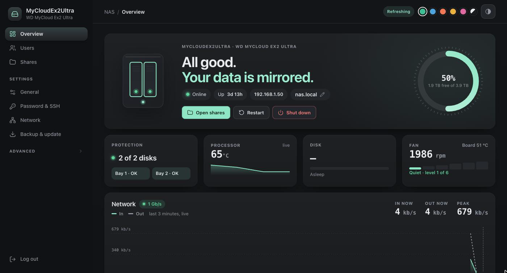

<div align="center">

# EX2 Ultra Reborn

**Turn a WD My Cloud EX2 Ultra into a quiet, simple, up-to-date NAS on OpenWrt.**

[](https://openwrt.org/toh/western_digital/mycloud_ex2_ultra) [](#supported-hardware) [](LICENSE)

[Getting started](#getting-started) · [Step-by-step blog post](https://argentrontech.com/blog/install-openwrt-wd-my-cloud-ex2-ultra) · [Documentation](#documentation) · [Safety](#safety) · [License](#license) · [argentrontech.com](https://argentrontech.com)



</div>

---

WD's firmware for the EX2 Ultra is nearing the end of its support, but the hardware is fine.
OpenWrt supports this NAS officially. This project adds what's missing to make it a
complete home NAS: a clean dashboard, fan control, health alerts and a one-command
installer. **Your existing data stays where it is.** WD's RAID 1 mirror is reused as is.

> [!TIP]
> New to OpenWrt? Read the beginner-friendly walkthrough on our blog:
> **[Install OpenWrt on a WD My Cloud EX2 Ultra with a Next-Gen NAS UI](https://argentrontech.com/blog/install-openwrt-wd-my-cloud-ex2-ultra)**

## Features

| Feature | What you get |
|---|---|
| **File sharing** | SMB shares for Mac, Windows and Linux, with a 30-day recycle bin |
| **Time Machine** | Mac backups with an optional size cap, discovered automatically |
| **Simple dashboard** | Users, shares, disks, temperatures and network on one page; works on phones |
| **Quiet fan** | WD's own temperature rules, decoded from the stock firmware |
| **Disk care** | Disks sleep when idle, monthly RAID check, SMART monitoring |
| **E-mail alerts** | Degraded RAID, failing or hot disk, full storage, stopped fan, unexpected restart |
| **Power** | Real power-off, Wake-on-LAN, optional idle power-off, overheat shutdown |
| **USB** | Drives are shared automatically; one-click copy or sync of folders to cold storage |
| **Private by default** | No cloud, no public IPv6, nothing exposed to the internet |

## Supported hardware

**WD My Cloud EX2 Ultra only**, with two disks in WD RAID 1.

Other WD models (Mirror Gen2, EX2100, EX4100, PR2100, …) use different hardware, so both
scripts check the device before doing anything and refuse to run elsewhere: the WD model
number `BVBZ` and flash layout before flashing, then the board and device tree on OpenWrt.

## Getting started

You need the NAS on your network and a Mac, Linux or Windows computer. On Windows, use
`.\preflight-wd.cmd` and `.\setup.cmd` in PowerShell or Command Prompt instead of the `.sh`
scripts ([details](docs/WINDOWS.md)).

**1. Check the model and back up the flash** (on WD firmware, read-only):

```sh
./preflight-wd.sh <NAS IP> --backup ./wd-flash-backup
```

**2. Install OpenWrt**: follow the [install guide](docs/INSTALL-OPENWRT.md).

**3. Set up the NAS**:

```sh
export NAS=root@<NAS IP>
ssh-copy-id $NAS

./setup.sh check        # read-only: model, disks, RAID
./setup.sh packages     # install the required packages
./setup.sh data         # reuse the WD data mirror (no disk writes)
./setup.sh install      # dashboard, fan control, alerts, disk sleep
ssh $NAS reboot
./setup.sh alerts       # optional: e-mail alerts (Gmail works, port 587)
```

Then open `http://nas.local` and create your users and shares. For e-mail alerts with Gmail
or your own mail server, see [e-mail alerts](docs/SETUP-GUIDE.md#8-e-mail-alerts-optional).
The [setup guide](docs/SETUP-GUIDE.md) walks through every step with screenshots.

## Documentation

| Guide | Contents |
|---|---|
| [Install OpenWrt](docs/INSTALL-OPENWRT.md) | Flash backup, flashing over SSH, first boot, recovery |
| [Setup guide](docs/SETUP-GUIDE.md) | `setup.sh` step by step, dashboard tour, connecting clients |
| [Windows](docs/WINDOWS.md) | The PowerShell / Command Prompt scripts, using the NAS from File Explorer |
| [Maintenance](docs/MAINTENANCE.md) | Health checks, upgrades, disks and RAID, fan, troubleshooting |
| [Blog post](https://argentrontech.com/blog/install-openwrt-wd-my-cloud-ex2-ultra) | The whole journey for beginners: exact OpenWrt version, flashing, setup, e-mail alerts |
| [CLAUDE.md](CLAUDE.md) | Hardware notes, rules and how to add features (for contributors and AI assistants) |

## Project layout

```
preflight-wd.sh      model check + flash backup, before flashing   (Windows: preflight-wd.cmd)
setup.sh             installer and updater, after flashing         (Windows: setup.cmd)
luci-app-nas/        dashboard pages and their backend
luci-theme-nasos/    "NAS OS" theme (based on LuCI Bootstrap)
nas-system/          fan control, alerts, power, RAID mount, USB, configs
mac/                 Wake-on-LAN helpers for Mac
windows/             PowerShell scripts behind the .cmd launchers, Wake-on-LAN for Windows
docs/                guides and screenshots
```

Updates: edit, then `./setup.sh update` (Windows: `.\setup.cmd update`). OpenWrt upgrades go through
**System → Attended Sysupgrade**, and everything installed here survives them.

## Safety

- **Back up first.** Copy anything irreplaceable off the NAS before flashing, and keep the
  flash backup from `preflight-wd.sh`. It's your way back to WD firmware.
- `setup.sh` never formats, creates or rebuilds RAID arrays, and never mounts a single RAID
  disk on its own (that would silently split the mirror).
- The microcontroller (fan and power) only receives the commands WD's own firmware sends.
- No secrets live in this repo: the alert e-mail password stays on the NAS.

Tested on OpenWrt 25.12.5 and 25.12.6. Found a problem?
[Open an issue](https://github.com/Argentron-Technologies/ex2-ultra-reborn/issues).

## License

[Apache License 2.0](LICENSE). The NAS OS theme builds on the
[LuCI Bootstrap theme](https://github.com/openwrt/luci) (Apache 2.0).

Not affiliated with Western Digital or the OpenWrt project. "My Cloud" is a trademark of
Western Digital.

---

<div align="center">

Made with ❤️ by **[Argentron Technologies Pvt. Ltd.](https://argentrontech.com)**

</div>
