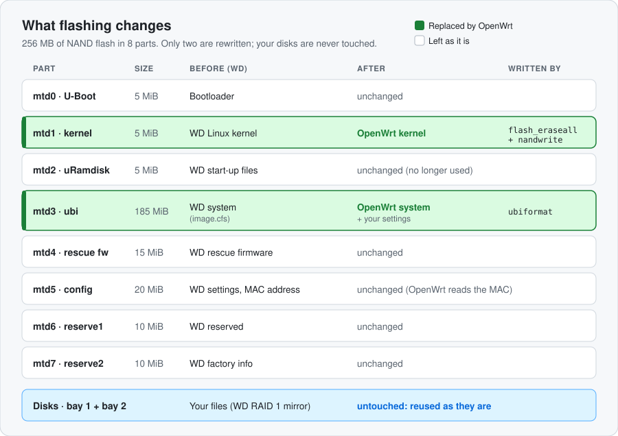

# Install OpenWrt

[← README](../README.md) · **Install OpenWrt** · [Setup guide](SETUP-GUIDE.md) · [Windows](WINDOWS.md) · [Maintenance](MAINTENANCE.md)

Replace WD's firmware with OpenWrt. This takes about 30 minutes, and **your disks and data
are not touched**. The steps follow the official
[OpenWrt device page](https://openwrt.org/toh/western_digital/mycloud_ex2_ultra). If the
two ever disagree, trust the wiki.

| You need | |
|---|---|
| The NAS | WD My Cloud EX2 Ultra, still on WD firmware, connected to your network |
| A computer | Mac, Linux or Windows 10/11, on the same network |
| This repo | `git clone` it, or *Code → Download ZIP* on GitHub |
| Optional | A 3.3 V USB-serial adapter, for recovery only |

> [!IMPORTANT]
> Back up anything irreplaceable first. Flashing doesn't touch the disks, but you are
> replacing the NAS's operating system.

---

## 1. Turn on SSH

In the WD dashboard, turn on **SSH** (network settings) and set its password. The SSH user is
`sshd`.

## 2. Check the model and back up the flash

Read-only. Continue only if it ends with **OK**.

**Mac / Linux**
```sh
./preflight-wd.sh <NAS IP> --backup ./wd-flash-backup
```

**Windows** (PowerShell or Command Prompt, in the repo folder)
```powershell
.\preflight-wd.cmd <NAS IP> -Backup .\wd-flash-backup
```

It checks for WD model number `BVBZ`, 2 drive bays and the exact EX2 Ultra flash layout,
then saves all 8 flash partitions with SHA-256 checksums.

> [!TIP]
> Keep the `wd-flash-backup` folder somewhere safe. It's your only way back to WD firmware.

<details>
<summary>Flash layout it expects</summary>

| mtd | Size | Name (WD) | Name (OpenWrt) |
|---|---|---|---|
| mtd0 | 5 MiB | U-Boot | U-Boot |
| mtd1 | 5 MiB | uImage | kernel |
| mtd2 | 5 MiB | uRamdisk | uRamdisk |
| mtd3 | 185 MiB | image.cfs | ubi |
| mtd4 | 15 MiB | rescue fw | rescue fw |
| mtd5 | 20 MiB | config | config |
| mtd6 | 10 MiB | reserve1 | reserve1 |
| mtd7 | 10 MiB | reserve2 | reserve2 |

</details>

## 3. Download OpenWrt

From [downloads.openwrt.org/releases](https://downloads.openwrt.org/releases/), open the
newest **25.12.x** → `targets/mvebu/cortexa9/`, and download these four files plus
`sha256sums` into an empty folder:

| File (ends with) | Used for |
|---|---|
| `wd_cloud-ex2-ultra-squashfs-uImage-factory.bin` | Install: the kernel |
| `wd_cloud-ex2-ultra-squashfs-image-cfs-factory.bin` | Install: the system |
| `wd_cloud-ex2-ultra-initramfs-kernel.bin` | Recovery only, keep it |
| `wd_cloud-ex2-ultra-squashfs-sysupgrade.bin` | Recovery only, keep it |

Check them. Every file must say **OK**:

**Mac / Linux**
```sh
shasum -a 256 -c sha256sums --ignore-missing
```

**Windows** (PowerShell)
```powershell
Get-Content sha256sums | ForEach-Object {
  $hash, $file = $_ -split " \*", 2
  if (Test-Path $file) { "{0}  {1}" -f $(if ((Get-FileHash $file -Algorithm SHA256).Hash -eq $hash) { "OK " } else { "BAD" }), $file }
}
```

## 4. Copy the images to the NAS

Keep **only one OpenWrt version** in the folder. Then:

**Mac / Linux**
```sh
ls *-uImage-factory.bin *-image-cfs-factory.bin       # exactly 2 files
scp -O *-uImage-factory.bin *-image-cfs-factory.bin sshd@<NAS IP>:/tmp/
```

**Windows** (PowerShell)
```powershell
$files = (Get-ChildItem *-uImage-factory.bin, *-image-cfs-factory.bin).Name
$files                                                 # exactly 2 files
scp -O $files sshd@<NAS IP>:/tmp/                      # Windows 10: leave out -O
```

`-O` selects the classic copy protocol, which WD's firmware may need. Newer `scp` versions
default to SFTP.

## 5. Flash

> [!WARNING]
> This is the step that changes the NAS. Run exactly these commands, from the wiki.

Only two of the eight flash parts are rewritten: the kernel (`mtd1`) and the system
(`mtd3`). The bootloader, WD's rescue firmware, its settings and your disks stay as they are.

<p align="center"></p>

```sh
ssh sshd@<NAS IP>
```
Then, on the NAS:
```sh
cd /tmp
ls -l *-uImage-factory.bin *-image-cfs-factory.bin      # exactly 2 files, same sizes as on your computer

flash_eraseall /dev/mtd1 && nandwrite --markbad -p /dev/mtd1 /tmp/*-uImage-factory.bin
ubiformat /dev/mtd3 -f /tmp/*-image-cfs-factory.bin -y

reboot
```

> [!CAUTION]
> Don't attach or check the new UBI from WD's firmware afterwards (for example
> `ubiattach -m 3`). The wiki reports this causes a reboot loop on first boot. Just reboot.

## 6. First boot

The first boot takes a few minutes. The fan runs at full speed and the LED blinks until
setup installs fan control. That's normal.

The NAS **gets its address from your router**, just like before. On this model OpenWrt
starts as a DHCP client, and it keeps WD's original MAC address, so the router usually gives
it the same IP as under WD's firmware. If not, look for it in your router's device list.

Log in (there's no password yet) and set a root password:

```sh
ssh root@<NAS IP> passwd
```

Give the NAS a fixed address (a DHCP reservation on your router is easiest), then continue
with the **[setup guide →](SETUP-GUIDE.md)**

---

## Recovery

As long as U-Boot (mtd0) is intact, the NAS can always be recovered. You'll need a 3.3 V
USB-serial adapter on header **JP2** (pin 1 RX, pin 2 GND, pin 5 TX; cross TX and RX; leave
3.3 V unconnected) at **115200** baud. U-Boot only stops on key **`1`**, and you have 1 second.

| Method | How |
|---|---|
| **USB stick** (easiest) | Put `initramfs-kernel.bin` on a FAT32 USB 2.0 stick. Stop U-Boot, then:<br>`usb start`<br>`fatload usb 0:1 0x02000000 openwrt-mvebu-cortexa9-wd_cloud-ex2-ultra-initramfs-kernel.bin;bootm 0x02000000 -` |
| **Serial (YMODEM)** | No network or stick needed, but slow (~10 min): `loady 0x02000000`, send the initramfs, then `iminfo 0x02000000` and `bootm 0x02000000` |
| **TFTP** | On the wiki, but on some units (U-Boot 2013.01 v1.04) U-Boot's network doesn't come up |

Once OpenWrt runs from RAM, copy the `sysupgrade.bin` to `/tmp` and run
`sysupgrade -n /tmp/<file>`.

> [!CAUTION]
> Never put a file named `/GrandTeton/u-boot.bin` on a USB stick you plug in: U-Boot can
> reflash itself from it.
