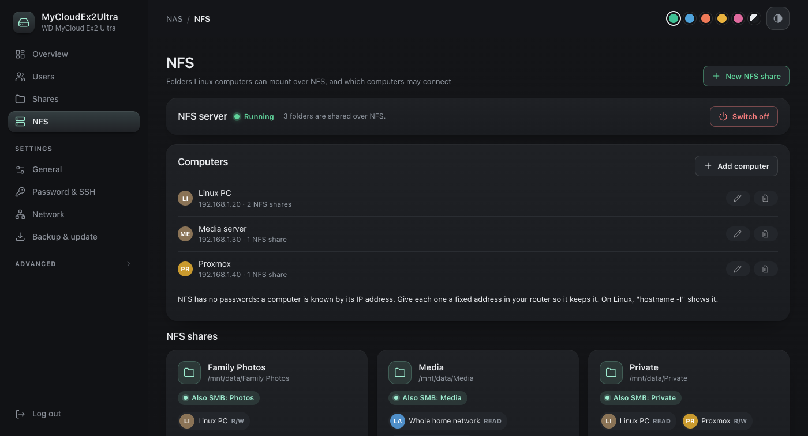
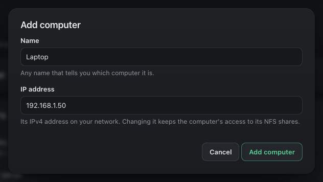
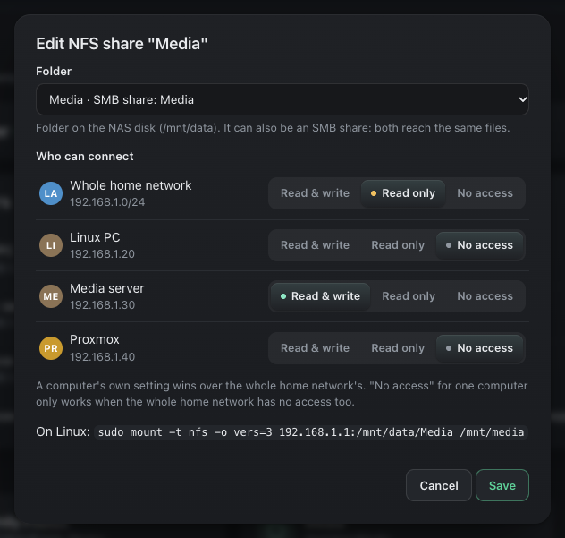
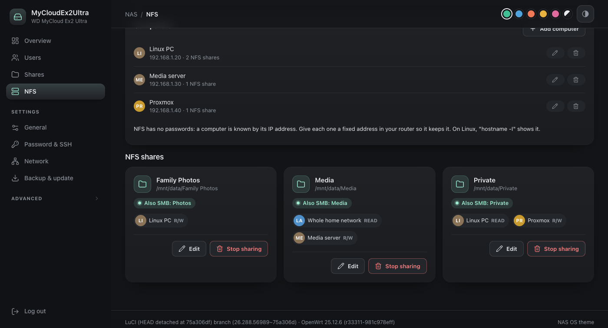

# NFS

[← README](../README.md) · [Install OpenWrt](INSTALL-OPENWRT.md) · [Setup guide](SETUP-GUIDE.md) · [Windows](WINDOWS.md) · **NFS** · [Maintenance](MAINTENANCE.md)

NFS lets Linux computers (and Macs) mount a NAS folder like a local disk: handy for
homelab servers such as Proxmox, Docker hosts or media servers. It is an **optional plugin**:
`setup.sh` never installs it. Once installed, the dashboard gets its own **NFS** page, next to
**Shares**.



> [!IMPORTANT]
> **NFS has no passwords.** It decides by **IP address** which computer may connect, and every
> allowed computer can read the folder (and change it, with *Read & write*). Use it on your own
> network only, never forward NFS ports on your router, and use SMB where a password matters.

---

## Install

From your computer, in the repo folder (Windows: `.\plugins.cmd` instead of `./plugins.sh`):

```sh
./plugins.sh nfs install
```

It installs the NFS server (NFSv3, about 5 MB of flash) and switches it on. Nothing is shared
yet. Reload the dashboard: the **NFS** page appears in the menu.

## 1. Add your computers

Under **Computers**, choose **Add computer** and enter a name and the computer's IP address.



- On Linux, `hostname -I` shows the address.
- Give each computer a **fixed address** in your router (DHCP reservation), so it keeps it.
  If an address changes anyway, edit the computer: its access moves to the new address.
- Removing a computer takes it off every NFS share. The folders and files stay.

## 2. Share a folder

Choose **New NFS share**, pick a folder, and set who may connect.



- **Folder**: any folder in `/mnt/data`, also one that is already an **SMB share** (the list
  says which). Both reach the same files. *New folder…* creates one. Time Machine folders
  can't be picked: changes made outside Time Machine break its backups.
- **Who can connect**: *Whole home network* and each of your computers, each *Read & write*,
  *Read only* or *No access*, just like users on an SMB share. A computer's own setting wins
  over the whole home network's. *No access* for one computer only works when the whole home
  network has no access too (NFS can't block one computer while it allows the network).
- The dialog shows the exact Linux `mount` command for the folder.

The NFS shares show as cards, with who may connect and an **Also SMB** chip when the folder is
an SMB share too:



**Stop sharing** only ends NFS access: the folder, its files and any SMB share stay.

## 3. Connect from Linux or a Mac

Use the NAS's **IP address**, not `nas.local` (a `.local` name can resolve to the NAS's IPv6
address, which isn't on the allowed list).

```sh
# Linux, once
sudo mount -t nfs -o vers=3 192.168.1.50:/mnt/data/Media /mnt/media

# Linux, at every start: add to /etc/fstab
192.168.1.50:/mnt/data/Media  /mnt/media  nfs  vers=3,_netdev  0  0
```

Mac: Finder → *Go → Connect to Server* → `nfs://192.168.1.50/mnt/data/Media`

Files written over NFS belong to `root` on the NAS, the same as files written over SMB, so both
kinds of access work on the same folders. NFS doesn't keep separate Linux owners per user.

## Switch NFS off

The **NFS server** bar at the top has **Switch off**. Then nothing is shared over NFS, also not
after a restart, but your computers and NFS shares are kept for when you switch it on again.
**Overview → Services → NFS (Linux)** shows the state and opens this page.

## Command line

Everything on the page can also be done from your computer. Both use the same list on the NAS,
so they always agree.

```sh
./plugins.sh nfs status                                # server, computers, shares, connected computers
./plugins.sh nfs computer-add "Linux PC" 192.168.1.20  # name a computer
./plugins.sh nfs computer-del "Linux PC"               # remove it (and its access)
./plugins.sh nfs add Media rw "Linux PC"               # one computer, read & write
./plugins.sh nfs add Media ro                          # whole home network, read-only
./plugins.sh nfs del Media "Linux PC"                  # take one computer off
./plugins.sh nfs del Media                             # stop sharing the folder
./plugins.sh nfs uninstall                             # remove NFS completely (files stay)
```

## Good to know

- **Writes are safe but a bit slower** than SMB: the NAS confirms each write only after it is
  on the disk. Reads are full speed.
- **Disks can still sleep**: NFS doesn't touch them while nothing is read or written. Some
  Linux file managers look into open folders now and then; if the disks never sleep while a
  computer has a folder mounted, close that window or unmount when you're done.
- **Idle power-off** counts a connected NFS computer as "in use", like an SMB connection.
- **OpenWrt upgrades** (Attended Sysupgrade) keep the NFS server, your computers and shares.
- **Remote computers** (outside your home): don't open NFS to the internet. Connect them over a
  VPN instead; the VPN address can then be added as a computer like any other.

## Troubleshooting

| Symptom | Fix |
|---|---|
| `access denied by server` | The computer isn't allowed on that share, or it connected over IPv6: mount with the NAS's IPv4 address. Check the share's card on the NFS page. |
| Mount hangs or "Connection refused" | The NFS server is off or stopped: see the bar at the top of the NFS page. Log: `logread \| grep -E "nas-nfs\|nfsd\|mountd"` |
| Computer lost access after its address changed | Edit the computer on the NFS page and enter the new address; its shares follow. A fixed address in the router prevents this. |
| No NFS page in the menu | NFS isn't installed (`./plugins.sh nfs install`), or the browser shows old pages: reload. |
| Can't pick a folder | Time Machine folders can't be NFS shares, and a folder that is already an NFS share is edited on its own card. |

> [!NOTE]
> NFS support is new. It was tested on OpenWrt 25.12.6 in a virtual machine with Linux and
> macOS computers, and on the dashboard; it hasn't been run on an EX2 Ultra yet. If something
> doesn't work, `./plugins.sh nfs uninstall` removes it completely, and an
> [issue](https://github.com/Argentron-Technologies/ex2-ultra-reborn/issues) helps us fix it.
