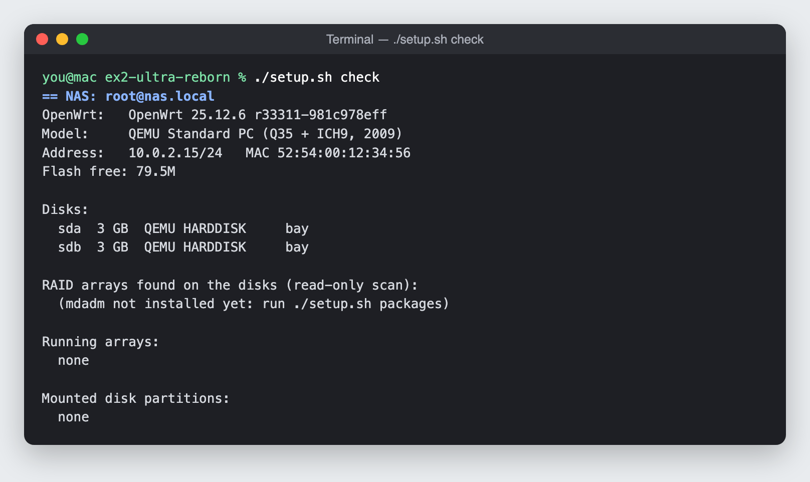
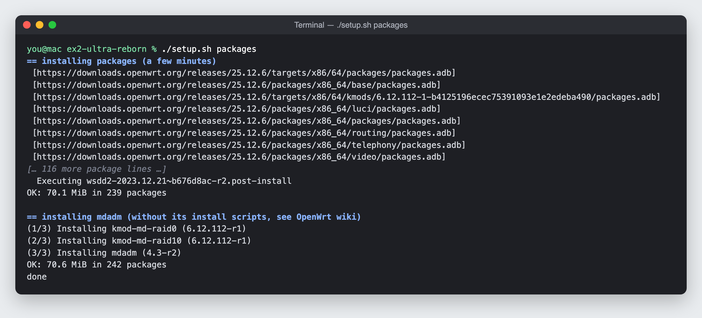
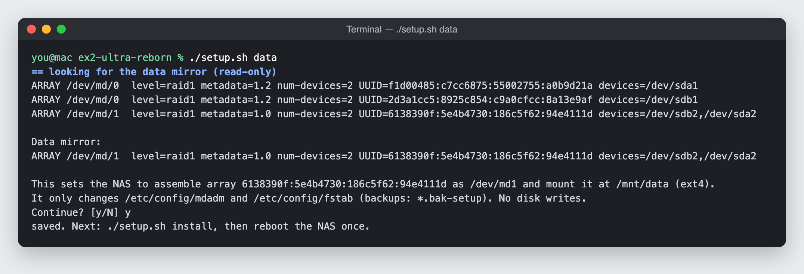
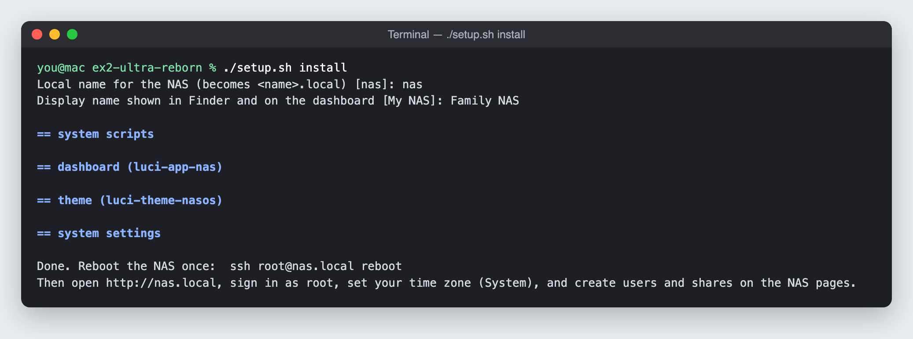
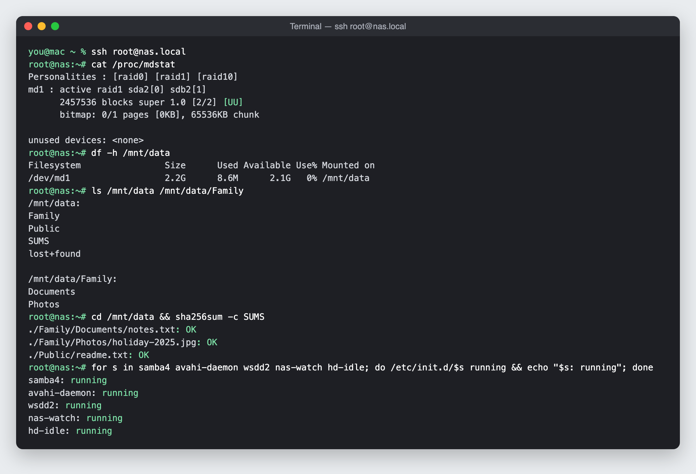
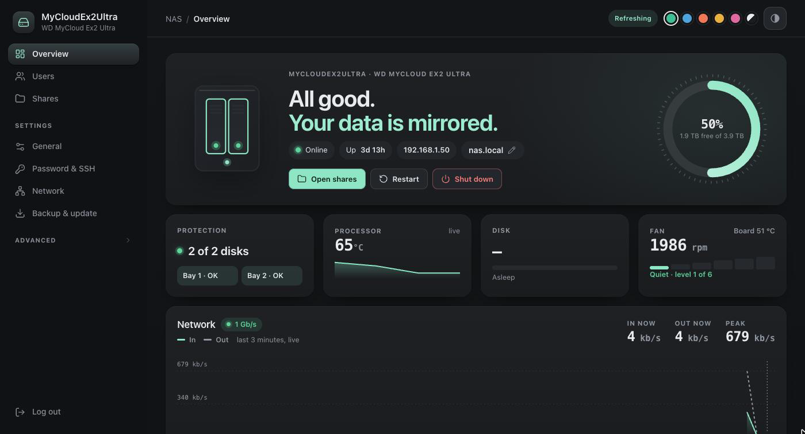
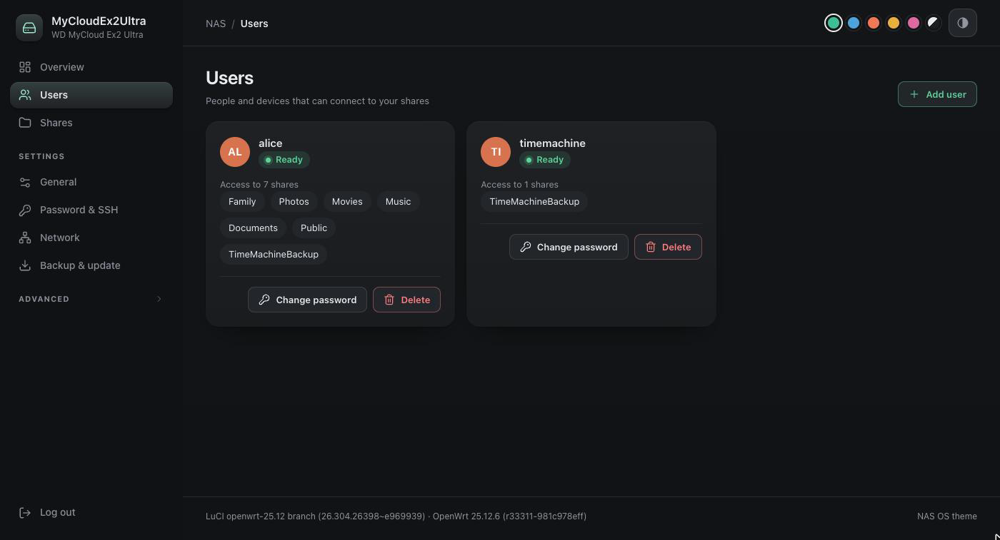
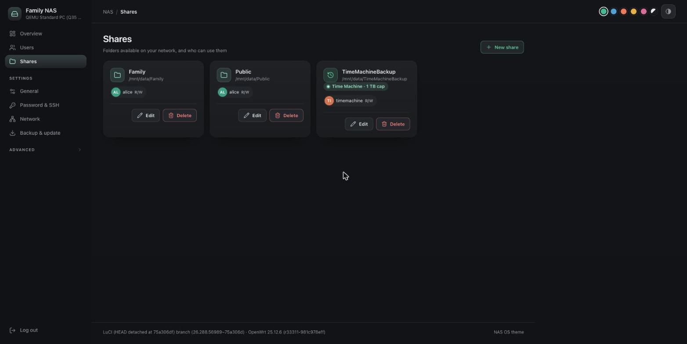

# Setup guide

[← README](../README.md) · [Install OpenWrt](INSTALL-OPENWRT.md) · **Setup guide** · [Windows](WINDOWS.md) · [Maintenance](MAINTENANCE.md)

Turn a freshly flashed EX2 Ultra into a working NAS in about 15 minutes. Your WD data mirror
is reused as is: nothing is formatted.

| You need | |
|---|---|
| The NAS | Running OpenWrt ([install guide](INSTALL-OPENWRT.md)), with internet access |
| A computer | Mac, Linux or Windows 10/11, on the same network |
| The NAS address | Its IP, from your router's device list |

The commands are the same on every system: Mac and Linux use `./setup.sh`, Windows uses
`.\setup.cmd` (in PowerShell or Command Prompt, in the repo folder).

---

## 1. Connect

**Mac / Linux**
```sh
export NAS=root@<NAS IP>
ssh-copy-id $NAS              # asks for the NAS root password once
```

**Windows**
```powershell
.\setup.cmd key -Nas <NAS IP>  # creates an SSH key if needed, asks for the root password once
```

From here on, no more passwords.

## 2. Check

Read-only. It confirms this is a WD My Cloud EX2 Ultra on OpenWrt and lists the disks.

```sh
./setup.sh check              # Windows: .\setup.cmd check
```



> [!NOTE]
> Taken on a finished NAS, so the RAID lines are already filled in. On a fresh install they
> appear after the next step.

## 3. Install packages

Takes a few minutes. mdadm is installed without its install scripts, as the OpenWrt wiki
advises for this NAS.

```sh
./setup.sh packages           # Windows: .\setup.cmd packages
```



## 4. Reuse your WD data

Finds WD's data mirror (partition 2 of both disks) and skips WD's swap arrays. It only
changes two config files and never writes to the disks. Answer **`y`**.

```sh
./setup.sh data               # Windows: .\setup.cmd data
```



## 5. Install the NAS software

Asks for a **local name** (`nas` → `nas.local`) and a **display name** (shown in Finder and
on the dashboard). Then it installs the dashboard, theme, fan control, alerts and disk sleep.

```sh
./setup.sh install            # Windows: .\setup.cmd install (offers to reboot)
ssh $NAS reboot
```



After the reboot, the mirror runs on both disks (`[UU]`), your files are untouched, and the
services are up:



## 6. Create users and shares

Open **`http://nas.local`** (or `http://<NAS IP>`) and sign in as `root`.

| Page | What to do |
|---|---|
| **Users** | Add the people and devices that may connect. Their password is what they type on their Mac or PC. |
| **Shares** | Pick folders to share and who may use them. Tick **Time Machine** on one share for Mac backups (optionally with a size cap). Other shares get a 30-day recycle bin. |
| **Overview** | Health at a glance: mirror, space, temperatures, fan, network. Restart and Shut down are here. |



<table>
<tr>
<td></td>
<td></td>
</tr>
</table>

## 7. Connect your computers

| | |
|---|---|
| **Mac** | Finder → Network, or *Go → Connect to Server* → `smb://nas.local`. Time Machine: *System Settings → General → Time Machine → Add Backup Disk*. |
| **Windows** | File Explorer → Network, or type `\\nas.local` in the address bar. See [Windows](WINDOWS.md). |
| **E-mail alerts** | Optional: `./setup.sh alerts` (Windows: `.\setup.cmd alerts`) |

**Done.** For day-to-day care, upgrades and troubleshooting, see
**[Maintenance →](MAINTENANCE.md)**
