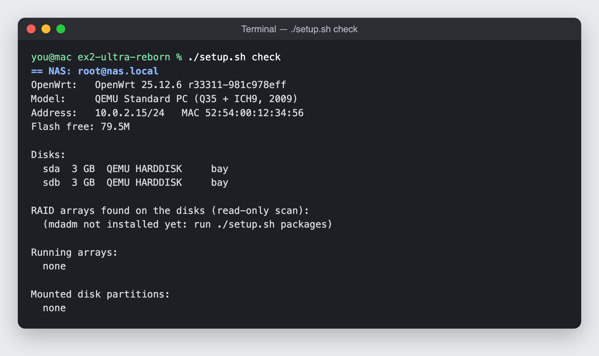
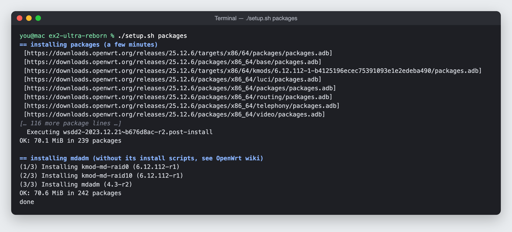
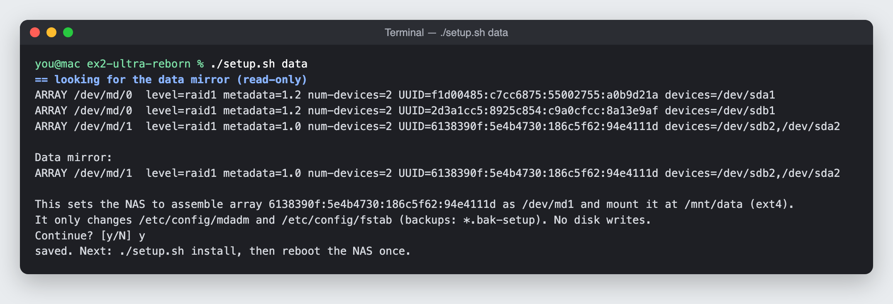
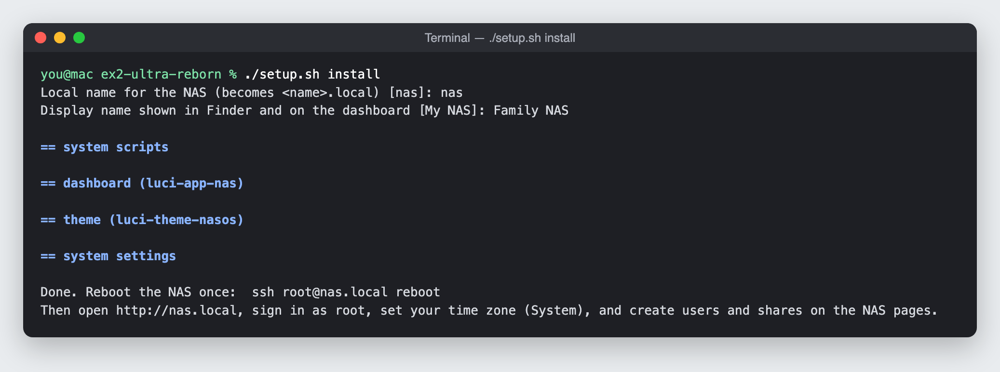
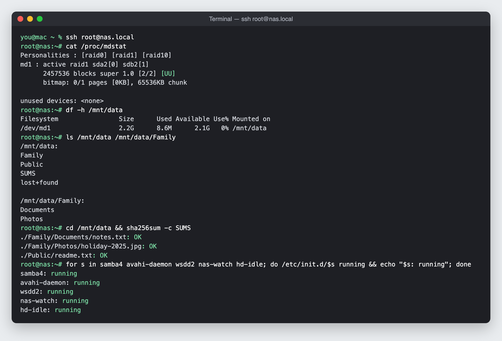
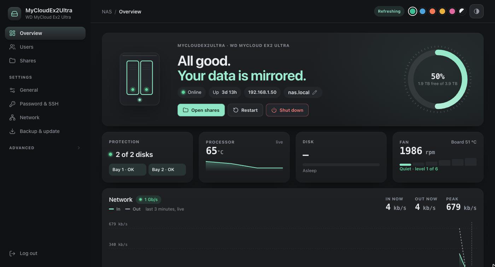
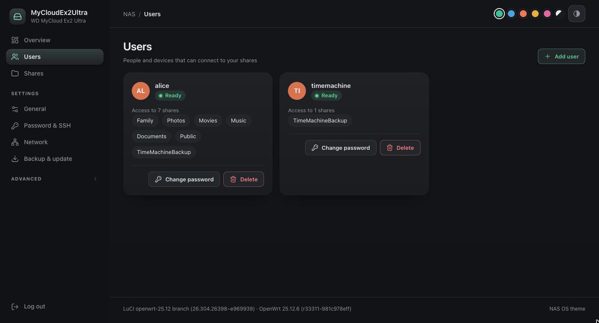
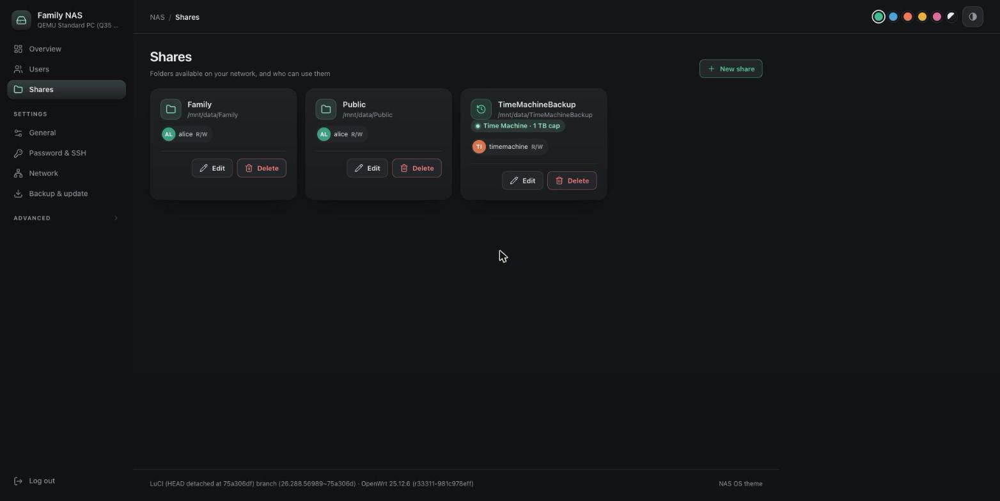

# Setup guide

[← README](../README.md) · [Install OpenWrt](INSTALL-OPENWRT.md) · **Setup guide** · [Windows](WINDOWS.md) · [Maintenance](MAINTENANCE.md)

Turn a freshly flashed EX2 Ultra into a working NAS in about 15 minutes. Your WD data mirror
is reused as is: nothing is formatted.

| You need | |
|---|---|
| The NAS | Running OpenWrt ([install guide](INSTALL-OPENWRT.md)), with internet access |
| A computer | Mac, Linux or Windows 10/11, on the same network |
| The NAS address | Its IP, from your router's device list |

The commands are the same on every system: Mac and Linux use `./setup.sh`, Windows uses
`.\setup.cmd` (in PowerShell or Command Prompt, in the repo folder).

---

## 1. Connect

**Mac / Linux**
```sh
export NAS=root@<NAS IP>
ssh-copy-id $NAS              # asks for the NAS root password once
```

**Windows**
```powershell
.\setup.cmd key -Nas <NAS IP>  # creates an SSH key if needed, asks for the root password once
```

From here on, no more passwords.

## 2. Check

Read-only. It confirms this is a WD My Cloud EX2 Ultra on OpenWrt and lists the disks.

```sh
./setup.sh check              # Windows: .\setup.cmd check
```



> [!NOTE]
> Taken on a finished NAS, so the RAID lines are already filled in. On a fresh install they
> appear after the next step.

## 3. Install packages

Takes a few minutes. mdadm is installed without its install scripts, as the OpenWrt wiki
advises for this NAS.

```sh
./setup.sh packages           # Windows: .\setup.cmd packages
```



## 4. Reuse your WD data

Finds WD's data mirror (partition 2 of both disks) and skips WD's swap arrays. It only
changes two config files and never writes to the disks. Answer **`y`**.

```sh
./setup.sh data               # Windows: .\setup.cmd data
```



## 5. Install the NAS software

Asks for a **local name** (`nas` → `nas.local`) and a **display name** (shown in Finder and
on the dashboard). Then it installs the dashboard, theme, fan control, alerts and disk sleep.

```sh
./setup.sh install            # Windows: .\setup.cmd install (offers to reboot)
ssh $NAS reboot
```



After the reboot, the mirror runs on both disks (`[UU]`), your files are untouched, and the
services are up:



## 6. Create users and shares

Open **`http://nas.local`** (or `http://<NAS IP>`) and sign in as `root`.

| Page | What to do |
|---|---|
| **Users** | Add the people and devices that may connect. Their password is what they type on their Mac or PC. |
| **Shares** | Pick folders to share and who may use them. Tick **Time Machine** on one share for Mac backups (optionally with a size cap). Other shares get a recycle bin (on by default; deleted files kept 30 days, adjustable on the Overview page). |
| **Overview** | Health at a glance: mirror, space, temperatures, fan, network. Restart and Shut down are here. |



<sub>Real EX2 Ultra dashboard; user and share names and the address are examples.</sub>

<table>
<tr>
<td></td>
<td></td>
</tr>
</table>

## 7. Connect your computers

| | |
|---|---|
| **Mac** | Finder → Network, or *Go → Connect to Server* → `smb://nas.local`. Time Machine: *System Settings → General → Time Machine → Add Backup Disk*. |
| **Windows** | File Explorer → Network, or type `\\nas.local` in the address bar. See [Windows](WINDOWS.md). |

## 8. E-mail alerts (optional)

The NAS can e-mail you when something needs attention: a disk drops out of the mirror, a
disk runs hot or reports SMART errors, storage is nearly full, the fan stops, or the NAS
restarts unexpectedly. Repeated alerts for the same problem are spaced out, so they won't
flood your inbox.

**Gmail:** turn on 2-Step Verification, then create an app password at
[myaccount.google.com/apppasswords](https://myaccount.google.com/apppasswords) and use it
below instead of your normal password.

```sh
./setup.sh alerts             # Windows: .\setup.cmd alerts
```

| It asks | Gmail | Your own mail server |
|---|---|---|
| `Send alerts to` | where alerts should go | any address |
| `SMTP server` | `smtp.gmail.com` | e.g. `mail.yourdomain.com` |
| `SMTP port (STARTTLS)` | `587` | `587` |
| `SMTP user` | your full Gmail address | your mailbox login |
| `From address` | press Enter (same as the user) | e.g. `nas@yourdomain.com` |
| `SMTP password (not shown)` | the app password | your mailbox password |

> [!IMPORTANT]
> Use port **587**: the NAS connects with STARTTLS. Port 465 won't work. On the first run
> the brackets show placeholders like `[smtp.example.com]`, so type real values.

It sends a test e-mail straight away and prints `Sent to …`. If it says `Sending failed`,
the reason is in `/tmp/nas-alert.log` on the NAS (`ssh root@nas.local cat /tmp/nas-alert.log`).
Run `alerts` again to fix a value: it shows your previous answers in brackets. Send a test
at any time with `ssh root@nas.local nas-alert test`.

The password is stored only on the NAS, in a file only `root` can read, never in this repo.

## 9. Optional plugins

Plugins are extras that `setup.sh` never installs. You add one only if you need it, and
can remove it again. List them, or show what one does:

```sh
./plugins.sh                  # Windows: .\plugins.cmd
./plugins.sh nfs              # Windows: .\plugins.cmd nfs
```

### NFS (for Linux computers)

NFS lets Linux computers mount a NAS folder like a local disk. SMB works from Linux too; use
NFS if you prefer it.

```sh
./plugins.sh nfs install                      # the NFS server (NFSv3, about 5 MB of flash)
./plugins.sh nfs add Media                    # read-write, for your whole home network
./plugins.sh nfs add "Family Photos" ro       # read-only
./plugins.sh nfs add Media rw 192.168.1.20    # only this one computer
./plugins.sh nfs status                       # shared folders, connected computers
./plugins.sh nfs del Media                    # stop sharing (files stay)
./plugins.sh nfs uninstall                    # remove it all again
```

Share the folder on the dashboard first: `add` shares an existing folder in `/mnt/data`.

**Or use the dashboard.** Once `install` has run, the dashboard shows NFS too, and both ways
see the same list:

- **Shares → Edit → NFS (Linux)**: tick it to share that folder over NFS, and choose *Read &
  write* or *Read only*. The dialog shows the exact `mount` command for Linux. The cards show
  an **NFS** chip.
- **Overview → Services → NFS (Linux)**: switch the NFS server off or on. Off stops all NFS
  sharing (also after a restart) but keeps your list of NFS folders for when you switch it on.

Then, using the NAS's IP address:

| | |
|---|---|
| **Linux** | `sudo mount -t nfs -o vers=3 <NAS IP>:/mnt/data/Media /mnt/media` |
| **Mac** | Finder → *Go → Connect to Server* → `nfs://<NAS IP>/mnt/data/Media` |

> [!WARNING]
> NFS has **no passwords**. Every computer you allow can read the folder, and with `rw` also
> change or delete its files. Allow only computers you trust, and never forward NFS ports on
> your router. Time Machine folders can't be shared over NFS: changes outside Time Machine
> break its backups.

Files written over NFS belong to `root`, the same as files written over SMB, so both kinds of
access work on the same folders.

**Good to know**

- Use the NAS's **IP address** to connect, not `nas.local`: a `.local` name can resolve to the
  NAS's IPv6 address, which isn't in the allowed network, and the mount is refused.
- NFS writes are **safe but a bit slower** than SMB: the NAS confirms each write only after it
  is on the disk. Reads are full speed.
- The NAS's **disks can still sleep**: NFS doesn't touch them while nothing is read or written.
  Some Linux file managers look into open folders now and then; if the disks never sleep while
  a Linux computer has a folder mounted, close that window or unmount when you're done.
- **Idle power-off** counts a connected NFS computer as "in use", like an SMB connection.
- **OpenWrt upgrades** (Attended Sysupgrade) keep the NFS server and your NFS folders.

> [!NOTE]
> NFS support is new. It was tested on OpenWrt 25.12.6 in a virtual machine, with Linux and
> macOS computers connecting, and on the dashboard; it hasn't been run on an EX2 Ultra yet.
> If something doesn't work, `./plugins.sh nfs uninstall` removes it completely, and an
> [issue](https://github.com/Argentron-Technologies/ex2-ultra-reborn/issues) helps us fix it.

**Done.** For day-to-day care, upgrades and troubleshooting, see
**[Maintenance →](MAINTENANCE.md)**
